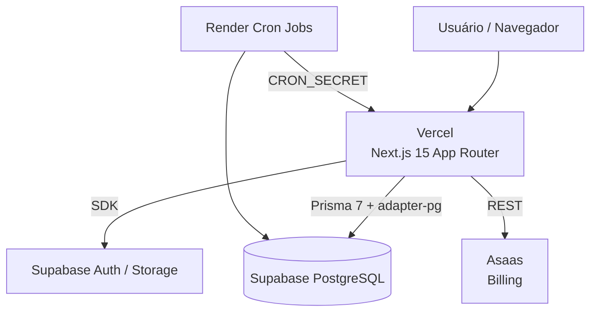

# BCTech — BritosCode HQ

Manual completo do ecossistema **BCTech / BritosCode HQ**: plataforma full-stack
multi-SaaS que centraliza identidade, tenants, assinaturas, suporte e ambientes
de demonstração.

- **Organização:** BritosCode.tech
- **Repositório:** https://github.com/JosemarBritoDev/BCTech
- **Branch principal:** `main`
- **Produtos:** BCModas, BC Health, BCTech Core

---

## Sumário

- [Visão geral](#visão-geral)
- [Arquitetura](#arquitetura)
- [Stack tecnológica](#stack-tecnológica)
- [Estrutura de pastas](#estrutura-de-pastas)
- [Pré-requisitos](#pré-requisitos)
- [Desenvolvimento local](#desenvolvimento-local)
- [Banco de dados](#banco-de-dados)
- [Scripts](#scripts)
- [Documentação](#documentação)
- [Deploy](#deploy)
- [Variáveis de ambiente](#variáveis-de-ambiente)
- [Segurança](#segurança)

---

## Visão geral

O BCTech é o núcleo (core) do ecossistema BritosCode. Ele mantém o catálogo de
produtos SaaS, os clientes (tenants), as assinaturas integradas ao Asaas, os
chamados de suporte e os sandboxes de demonstração isolados.

| Produto | Papel | Status |
| --- | --- | --- |
| **BCModas** | Gestão para varejo de moda | ACTIVE |
| **BC Health** | Gestão clínica e prontuário | BETA |
| **BCTech Core** | Núcleo do ecossistema | ACTIVE |

## Arquitetura



- **Monólito modular** com App Router e React Server Components.
- **Multi-tenant** com `Tenant` como fronteira de isolamento.
- **Multi-produto** via `SaasProduct` + `Subscription`.
- **Sandboxes isolados** por schema PostgreSQL, com reset via cron.
- **Billing** integrado ao Asaas (customer + subscription ids).

Detalhes em [`docs/ARQUITETURA.md`](docs/ARQUITETURA.md) e
[`docs/DATABASE_SCHEMA.md`](docs/DATABASE_SCHEMA.md).

## Stack tecnológica

| Camada | Tecnologia |
| --- | --- |
| Framework | Next.js 15.5 (App Router, Turbopack) |
| Linguagem | TypeScript 5 (`strict`) |
| Estilo | Tailwind CSS 4, `clsx`, `tailwind-merge` |
| Ícones | `lucide-react` |
| ORM | Prisma 7 (`prisma-client` + `@prisma/adapter-pg`) |
| Banco | PostgreSQL (Supabase) |
| SDK | `@supabase/supabase-js` |
| Qualidade | ESLint 9, `eslint-config-next` |
| Deploy | Vercel (app), Supabase (dados), Render (cron/workers) |

## Estrutura de pastas

```text
.
├── docs/                      # Documentação técnica (versionada)
│   ├── AGENTS.md              # Papéis dos agentes de IA
│   ├── DATABASE_SCHEMA.md     # Especificação das entidades
│   ├── SANDBOX_DEMO.md        # Sandboxes e reset via cron
│   ├── ARQUITETURA.md
│   ├── BANCO-DE-DADOS.md
│   └── AMBIENTE.md
├── prisma/
│   ├── schema.prisma          # Modelos, enums e relações
│   └── seed.ts                # Seed idempotente dos produtos
├── public/                    # Assets estáticos
├── src/
│   ├── app/                   # App Router
│   ├── generated/             # Prisma Client (ignorado no Git)
│   └── lib/                   # Utilitários e integrações
├── .env.example
├── prisma.config.ts
├── next.config.ts
└── tsconfig.json
```

## Pré-requisitos

| Ferramenta | Versão mínima |
| --- | --- |
| Node.js | 20 LTS |
| npm | 10 |
| Git | 2.40 |
| Conta Supabase | — |
| Conta Vercel | — (deploy) |
| Conta Render | — (cron) |

## Desenvolvimento local

```bash
# 1. Clonar e instalar
git clone https://github.com/JosemarBritoDev/BCTech.git
cd BCTech
npm ci

# 2. Configurar variáveis
cp .env.example .env
# edite .env com DATABASE_URL e chaves do Supabase

# 3. Preparar o banco
npx prisma migrate dev --name init
npm run db:seed

# 4. Subir o servidor
npm run dev
```

Acesse **http://localhost:3000**.

Fluxo diário:

```bash
git switch -c feat/minha-feature
npm run dev
npm run lint && npm run typecheck
git commit -m "feat: minha feature"
git push origin feat/minha-feature
```

## Banco de dados

O schema fica em `prisma/schema.prisma` e é documentado em
[`docs/DATABASE_SCHEMA.md`](docs/DATABASE_SCHEMA.md).

```bash
npx prisma validate          # valida o schema
npm run db:generate          # gera o client em src/generated/prisma
npm run db:migrate -- --name nome_da_migration
npm run db:seed              # popula BCModas, BC Health e BCTech Core
npm run db:studio            # interface visual
npm run db:push              # prototipação (sem migration)
```

Em produção/CI:

```bash
npx prisma migrate deploy
```

> Prisma 7 exige driver adapter. O projeto usa `@prisma/adapter-pg`.

## Scripts

| Script | Descrição |
| --- | --- |
| `npm run dev` | Servidor de desenvolvimento (Turbopack) |
| `npm run build` | Build de produção |
| `npm run start` | Servidor de produção |
| `npm run lint` | ESLint |
| `npm run typecheck` | TypeScript sem emitir |
| `npm run db:generate` | Gera o Prisma Client |
| `npm run db:seed` | Executa `prisma/seed.ts` |
| `npm run db:migrate` | Cria/aplica migrations |
| `npm run db:push` | Sincroniza schema sem migration |
| `npm run db:studio` | Prisma Studio |

## Documentação

| Documento | Conteúdo |
| --- | --- |
| [`docs/AGENTS.md`](docs/AGENTS.md) | Papéis dos agentes (Architect, Prisma DB, UI, DevOps) |
| [`docs/DATABASE_SCHEMA.md`](docs/DATABASE_SCHEMA.md) | Entidades, enums, índices e ERD |
| [`docs/SANDBOX_DEMO.md`](docs/SANDBOX_DEMO.md) | Isolamento de demos e reset por cron |
| [`docs/ARQUITETURA.md`](docs/ARQUITETURA.md) | Visão arquitetural e convenções |
| [`docs/BANCO-DE-DADOS.md`](docs/BANCO-DE-DADOS.md) | Prisma, migrations e Supabase |
| [`docs/AMBIENTE.md`](docs/AMBIENTE.md) | Setup e variáveis de ambiente |

> A pasta `docs/` é versionada — não a adicione ao `.gitignore`.

## Deploy

### 1. Supabase (PostgreSQL)

```bash
# instalar CLI
npm i -g supabase

# autenticar e vincular o projeto
supabase login
supabase link --project-ref <PROJECT_REF>

# aplicar o schema via Prisma (recomendado)
npx prisma migrate deploy
npm run db:seed
```

- Obtenha a connection string em **Project Settings → Database** e configure
  `DATABASE_URL` (use o pooler para serverless).
- Habilite RLS nas tabelas expostas e revise as políticas por tenant.
- Mantenha backups automáticos ativos.

### 2. Vercel (aplicação Next.js)

```bash
npm i -g vercel
vercel link
vercel env add DATABASE_URL production
vercel env add NEXT_PUBLIC_SUPABASE_URL production
vercel env add NEXT_PUBLIC_SUPABASE_ANON_KEY production
vercel env add SUPABASE_SERVICE_ROLE_KEY production
vercel env add CRON_SECRET production
vercel --prod
```

- Build command: `npm run build` (a Vercel roda `npm ci` automaticamente).
- Configure `vercel.json` com os crons de sandbox:

```json
{
  "crons": [
    {
      "path": "/api/cron/reset-sandboxes",
      "schedule": "0 3 * * *"
    }
  ]
}
```

- Cada Pull Request gera um preview deployment isolado.

### 3. Render (cron e workers)

1. Crie um **Cron Job** em Render apontando para o endpoint de reset.
2. Comando:

```bash
curl -fsS -X POST https://bctech.britoscode.tech/api/cron/reset-sandboxes \
  -H "Authorization: Bearer $CRON_SECRET"
```

3. Agenda recomendada: `0 3 * * *`.
4. Para workers de longa duração, use um **Background Worker** com o mesmo
   runtime Node 20 e as variáveis de ambiente do projeto.

Detalhes em [`docs/SANDBOX_DEMO.md`](docs/SANDBOX_DEMO.md).

### Ordem recomendada de deploy

```text
1. Supabase  → banco + migrations
2. Vercel    → aplicação + preview
3. Render    → crons/workers
4. Smoke test (home, login, seed, cron autenticado)
```

## Variáveis de ambiente

| Variável | Escopo | Obrigatória | Descrição |
| --- | --- | --- | --- |
| `DATABASE_URL` | servidor | sim | Connection string PostgreSQL (Prisma) |
| `NEXT_PUBLIC_SUPABASE_URL` | browser/servidor | sim | URL do projeto Supabase |
| `NEXT_PUBLIC_SUPABASE_ANON_KEY` | browser/servidor | sim | Chave anônima pública |
| `SUPABASE_SERVICE_ROLE_KEY` | servidor | sim (admin) | Chave administrativa |
| `CRON_SECRET` | servidor | sim (cron) | Protege endpoints de cron |

`NEXT_PUBLIC_*` é público por definição — nunca coloque segredos nelas.

## Segurança

- `.env` nunca é versionado; apenas `.env.example`.
- Nunca commite chaves do Supabase ou do Asaas.
- RLS habilitado nas tabelas multi-tenant.
- Endpoints de cron protegidos por `CRON_SECRET`.
- Dependências auditadas com `npm audit` antes de cada release.
- Sandboxes sem acesso a dados reais ou credenciais de produção.

---

© BritosCode.tech — BCTech / BritosCode HQ
