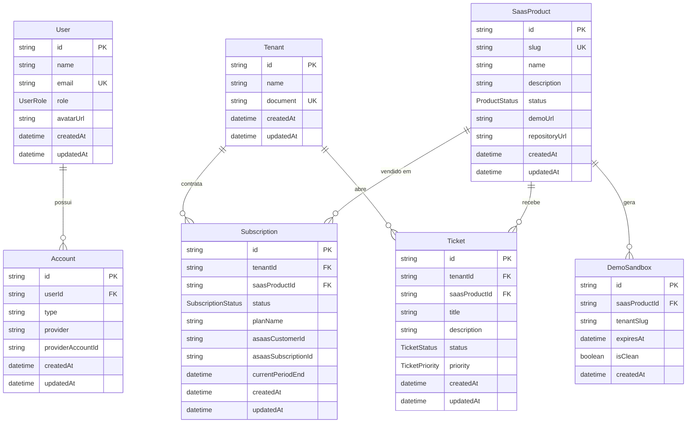

# Especificação do Banco de Dados

Schema oficial do ecossistema **BCTech / BritosCode HQ** em PostgreSQL (Supabase),
modelado com **Prisma 7**.

- Arquivo fonte: [`prisma/schema.prisma`](../prisma/schema.prisma)
- Configuração: [`prisma.config.ts`](../prisma.config.ts)
- Seed: [`prisma/seed.ts`](../prisma/seed.ts)
- Client gerado: `src/generated/prisma` (ignorado no Git)

## Diagrama de entidades



## Enums

| Enum | Valores | Uso |
| --- | --- | --- |
| `UserRole` | `ADMIN`, `CLIENT` | Nível de acesso do usuário |
| `ProductStatus` | `ACTIVE`, `BETA`, `DEMO` | Estágio de cada produto SaaS |
| `SubscriptionStatus` | `ACTIVE`, `INACTIVE`, `OVERDUE`, `CANCELLED` | Situação da assinatura |
| `TicketStatus` | `OPEN`, `IN_PROGRESS`, `RESOLVED` | Andamento do chamado |
| `TicketPriority` | `LOW`, `MEDIUM`, `HIGH` | Urgência do chamado |

## Entidades

### `User` → tabela `users`

Representa uma pessoa autenticada no ecossistema.

| Campo | Tipo | Regras |
| --- | --- | --- |
| `id` | `String` | PK, `cuid()` |
| `name` | `String` | Obrigatório |
| `email` | `String` | Único, obrigatório |
| `role` | `UserRole` | Default `CLIENT` |
| `avatarUrl` | `String?` | Opcional |
| `createdAt` | `DateTime` | Default `now()` |
| `updatedAt` | `DateTime` | `@updatedAt` |

Relações: `accounts Account[]`.

### `Account` → tabela `accounts`

Vínculo entre um usuário e um provedor externo de identidade (Supabase Auth,
OAuth, SSO). Permite múltiplos provedores por usuário.

| Campo | Tipo | Regras |
| --- | --- | --- |
| `id` | `String` | PK, `cuid()` |
| `userId` | `String` | FK → `User.id`, `onDelete: Cascade` |
| `type` | `String` | Default `"oauth"` |
| `provider` | `String` | Ex.: `supabase`, `google`, `github` |
| `providerAccountId` | `String` | ID do usuário no provedor |
| `createdAt` | `DateTime` | Default `now()` |
| `updatedAt` | `DateTime` | `@updatedAt` |

Restrições: `@@unique([provider, providerAccountId])` e índice em `userId`.

### `SaasProduct` → tabela `saas_products`

Catálogo de produtos do ecossistema (BCModas, BC Health, BCTech Core).

| Campo | Tipo | Regras |
| --- | --- | --- |
| `id` | `String` | PK, `cuid()` |
| `slug` | `String` | Único, identificador de URL |
| `name` | `String` | Nome comercial |
| `description` | `String` | Descrição pública |
| `status` | `ProductStatus` | Default `ACTIVE` |
| `demoUrl` | `String?` | URL do ambiente de demonstração |
| `repositoryUrl` | `String?` | Repositório do produto |
| `createdAt` | `DateTime` | Default `now()` |
| `updatedAt` | `DateTime` | `@updatedAt` |

Relações: `subscriptions`, `demoSandboxes`, `tickets`.

### `Tenant` → tabela `tenants`

Cliente/organização que consome um ou mais produtos.

| Campo | Tipo | Regras |
| --- | --- | --- |
| `id` | `String` | PK, `cuid()` |
| `name` | `String` | Razão social ou nome fantasia |
| `document` | `String` | Único (CPF/CNPJ) |
| `createdAt` | `DateTime` | Default `now()` |
| `updatedAt` | `DateTime` | `@updatedAt` |

Relações: `subscriptions`, `tickets`.

### `Subscription` → tabela `subscriptions`

Contrato de billing entre tenant e produto, integrado ao **Asaas**.

| Campo | Tipo | Regras |
| --- | --- | --- |
| `id` | `String` | PK, `cuid()` |
| `tenantId` | `String` | FK → `Tenant.id`, `onDelete: Cascade` |
| `saasProductId` | `String` | FK → `SaasProduct.id`, `onDelete: Restrict` |
| `status` | `SubscriptionStatus` | Default `ACTIVE` |
| `planName` | `String` | Nome do plano contratado |
| `asaasCustomerId` | `String?` | ID do cliente no Asaas |
| `asaasSubscriptionId` | `String?` | ID da assinatura no Asaas |
| `currentPeriodEnd` | `DateTime?` | Fim do período vigente |
| `createdAt` | `DateTime` | Default `now()` |
| `updatedAt` | `DateTime` | `@updatedAt` |

Índices: `tenantId`, `saasProductId`, `status`, `currentPeriodEnd`.

> `Restrict` no produto evita apagar um SaaS que ainda possui assinaturas.

### `DemoSandbox` → tabela `demo_sandboxes`

Instância isolada de demonstração de um produto. Ver
[`SANDBOX_DEMO.md`](./SANDBOX_DEMO.md).

| Campo | Tipo | Regras |
| --- | --- | --- |
| `id` | `String` | PK, `cuid()` |
| `saasProductId` | `String` | FK → `SaasProduct.id`, `onDelete: Cascade` |
| `tenantSlug` | `String` | Identificador do sandbox (URL/subdomínio) |
| `expiresAt` | `DateTime` | Expiração/TTL |
| `isClean` | `Boolean` | Default `true` — indica reset concluído |
| `createdAt` | `DateTime` | Default `now()` |

Restrições: `@@unique([saasProductId, tenantSlug])`; índices em `tenantSlug`,
`expiresAt` e `isClean`.

### `Ticket` → tabela `tickets`

Chamado de suporte de um tenant sobre um produto.

| Campo | Tipo | Regras |
| --- | --- | --- |
| `id` | `String` | PK, `cuid()` |
| `tenantId` | `String` | FK → `Tenant.id`, `onDelete: Cascade` |
| `saasProductId` | `String` | FK → `SaasProduct.id`, `onDelete: Restrict` |
| `title` | `String` | Resumo do problema |
| `description` | `String` | Detalhamento |
| `status` | `TicketStatus` | Default `OPEN` |
| `priority` | `TicketPriority` | Default `MEDIUM` |
| `createdAt` | `DateTime` | Default `now()` |
| `updatedAt` | `DateTime` | `@updatedAt` |

Índices compostos: `(tenantId, status)`; simples: `saasProductId`, `priority`.

## Convenções de modelagem

- IDs opacos com `cuid()` — seguros para exposição em URLs.
- Nomes de tabelas em `snake_case` via `@@map`.
- `createdAt`/`updatedAt` em todas as entidades de domínio.
- Chaves estrangeiras sempre com ação explícita (`Cascade` ou `Restrict`).
- Enums no banco (não strings livres) para estados de negócio.
- Índices em colunas usadas por filtros, ordenação e joins.

## Seed

`prisma/seed.ts` é **idempotente** e usa `upsert` por `slug`:

| Slug | Produto | Status |
| --- | --- | --- |
| `bcmodas` | BCModas | `ACTIVE` |
| `bc-health` | BC Health | `BETA` |
| `bctech-core` | BCTech Core | `ACTIVE` |

Execução:

```bash
npm run db:seed            # via prisma.config.ts (tsx prisma/seed.ts)
```

## Migrations

```bash
npx prisma validate
npx prisma migrate dev --name nome_da_migration
npx prisma generate
npm run db:seed
```

Em produção:

```bash
npx prisma migrate deploy
```

## Multi-tenancy e RLS (Supabase)

- `Tenant` é a fronteira de isolamento lógica.
- Em tabelas com `tenantId`, habilitar **Row Level Security** no Supabase.
- Políticas devem derivar o tenant do JWT (`auth.jwt() -> 'tenant_id'`).
- O sandbox de demonstração nunca compartilha dados com tenants reais
  (ver `SANDBOX_DEMO.md`).

## Checklist de alteração de schema

- [ ] Modelo documentado neste arquivo.
- [ ] `npx prisma validate` sem erros.
- [ ] Migration revisada e versionada.
- [ ] `npx prisma generate` executado.
- [ ] Seed atualizado (se necessário) e idempotente.
- [ ] `npm run lint` e `npm run typecheck` verdes.
